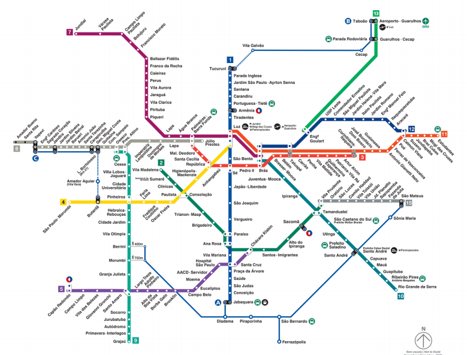

# Metrô de São Paulo | Modelagem de rede com grafos

Modelagem da rede de transporte metropolitano de São Paulo com dados tabulares, grafos e visualizações.

**Formação e fundamentos** · Projeto de curso

[← Portfólio de Thiago Oliveira](https://github.com/thiagoramos20042/thiagoramos20042) · [Catálogo de projetos](https://github.com/thiagoramos20042/thiagoramos20042/blob/main/PROJETOS.md)

## Objetivo

Transformar dados de estações e conexões em uma representação de rede para estudar trajetos.

## O que você encontra

- Preparação de dados de estações e linhas.
- Construção e exploração de grafos da rede.
- Notebooks, arquivos de apoio e mapa de referência.

## Tecnologias

Python · NetworkX · pandas · NumPy · geopy · Matplotlib

## Arquivos principais

| Arquivo | Conteúdo |
| --- | --- |
| [ProjetoRedeMetroSP_SquadCinza.ipynb](ProjetoRedeMetroSP_SquadCinza.ipynb) | Notebook de construção e exploração da rede. |
| [ProjetoRedeMetroSP_SquadCinzaV10.ipynb](ProjetoRedeMetroSP_SquadCinzaV10.ipynb) | Versão complementar do trabalho. |
| [sp_transporte.csv](sp_transporte.csv) | Dados tabulares de transporte. |
| [Mapa.png](Mapa.png) | Mapa de referência. |

## Como explorar

Abra [ProjetoRedeMetroSP_SquadCinza.ipynb](ProjetoRedeMetroSP_SquadCinza.ipynb) no visualizador do GitHub para acompanhar o código e as saídas salvas. Para explorar as células, use Jupyter ou a extensão de notebooks do VS Code. Antes de executar, confira os caminhos de entrada, as fontes externas e os imports nas primeiras células.

## Visualização

## Contexto do projeto

Projeto acadêmico em equipe, identificado nos arquivos como Squad Cinza. O mapa e os dados representam o recorte do exercício.

---

Integra o [portfólio de Thiago Oliveira](https://github.com/thiagoramos20042).
